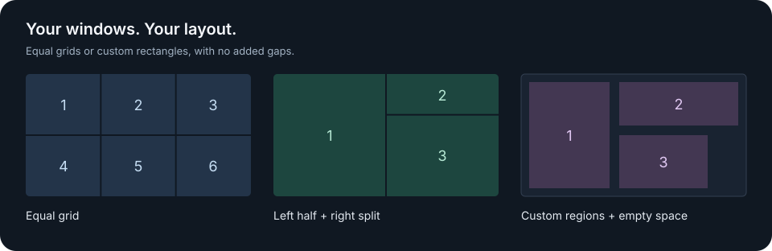

<div align="center">

# Tile

**A small macOS menu bar app that puts windows where they belong.**

Zero-gap grids · Custom rectangular regions · Saved layouts

[Release status](https://github.com/ralphite/tile/releases) · [Quick start](#quick-start) · [Build from source](#build-from-source) · [Report an issue](https://github.com/ralphite/tile/issues/new/choose)




</div>

Tile lives in the menu bar. Pick a layout to arrange the normal windows on the current macOS desktop (Space). Start with a grid, define your own rectangles, or save the arrangement already on your screen.

> **Development status:** Basic grid placement has been reported failing with real mixed-application windows. This takes precedence over earlier isolated Chrome test results. Binary releases are on hold until the normal placement workflow is fixed and verified. Drag snapping also remains unverified with a physical mouse. See [QA.md](QA.md).

## What it does

| Feature | Behavior |
| --- | --- |
| One-click arrangement | Apply a saved layout to the frontmost eligible windows on each display. |
| Flexible grids | Default 2×3, 3×3 and 3×4 layouts; rows and columns are editable. |
| Custom regions | Draw a layout through grid coordinates: any rectangular regions, with empty space allowed and overlap rejected. |
| Zero gaps | Adjacent regions share boundaries, without added padding. |
| Drag snapping | Choose **Snap Layout**, enable **Drag Snapping**, drag a window into a region, and release to fill it. The intended behavior leaves manual resizing free. |
| Capture a layout | Select windows from a list, inspect the preview, and save their positions and sizes as a new preset. |
| Restore | Undo the last arrangement or snap during the current app session. |

Layouts store **regions, not app assignments**. If a layout has six regions and there are eight windows, only the first six are arranged; the other two stay in place. Each display is handled separately.

## Quick start

1. [Build from source](#build-from-source). A binary release is not available yet because normal grid placement is under repair.
2. Keep the resulting `Tile.app` in a stable location. It requires **macOS 13 or later** and builds for the current machine’s architecture.
3. Open Tile. It runs in the menu bar and does not keep a Dock icon.
4. Choose **Allow Accessibility…**, then enable Tile in **System Settings → Privacy & Security → Accessibility**.
5. Click the grid icon and choose a layout. **Edit Layouts…** opens the editor; its **Arrange Windows…** button opens the same arrangement menu.

The current binary is signed with a dedicated local development identity, **not an Apple Developer ID**, and is **not notarized**. macOS may block the download on first launch. Review [Apple’s guidance for opening apps safely](https://support.apple.com/en-us/102445), or build from source. Do not disable Gatekeeper globally.

### Create a custom layout

Open **Edit Layouts… → + New Layout → Custom Regions**. Choose the base grid, select a numbered region, then set **Left**, **Top**, **Width**, and **Height** in grid cells. Left and Top start at zero.

For a 12×12 base grid:

| Region | Left | Top | Width | Height |
| --- | ---: | ---: | ---: | ---: |
| Left half | 0 | 0 | 6 | 12 |
| Upper-right third | 6 | 0 | 6 | 4 |
| Lower-right two thirds | 6 | 4 | 6 | 8 |

The preview updates while editing. Regions may touch but cannot overlap or extend beyond the base grid. **Save** updates the selected preset; **Save a Copy** creates another preset. Changing base-grid dimensions changes the proportions of the existing cell coordinates.

### Snap an individual window

1. Choose a preset in **Snap Layout**. Selecting it does not rearrange other windows.
2. Choose **Enable Drag Snapping**.
3. Move a window by its title bar. Regions appear during a detected move; the region under the pointer is highlighted.
4. Release inside a region to fill it. Releasing over empty space leaves the window where it was dropped.

Use **Disable Drag Snapping** to return to normal dragging. Snapping starts off when Tile launches. It uses mouse-event notifications while enabled, with no idle polling. Manual resizing is excluded from snapping. Physical-mouse acceptance testing for this feature remains pending in v0.3.0.

### Save the arrangement on screen

Arrange and resize windows, then choose **Save Current Windows as Layout…**:

- Select the display and check the windows to include. Background windows can be excluded.
- Click **Refresh Windows** after moving or resizing windows while the capture window is open.
- Check the preview and enter a name. Selected regions must be inside the usable display and must not overlap.
- Choose **Save as New Layout**. Existing presets stay intact.

Captured coordinates use the display’s point dimensions as the base grid to preserve normal manual placements accurately. The resulting preset scales with the usable display area and can be edited like any other custom layout.

## Scope, privacy, and limitations

- Tile acts on visible, movable, resizable normal windows in the current Space. Hidden, minimized, fullscreen, and modal windows are excluded.
- Applications can impose minimum sizes or reject a position. Tile reports limited or failed adjustments in its menu.
- Chrome may need a **1-point reserve at the Dock edge** to accept a resize. This is an outer system boundary; internal region gaps remain zero.
- A snap moves the dragged window only. It does not swap or evict an existing window in the target region.
- Screen Recording permission is not required. The app has no network client, analytics, account, or cloud service. Window titles appear only in the capture picker; saved layouts contain geometry and names, not window titles or app identities.
- Window matching uses the private macOS symbol `_AXUIElementGetWindow`, since no public AX-to-CG-window-ID bridge is available. Tile stops window operations if this symbol is missing. macOS upgrades may require compatibility work.
- Cross-Space isolation, multiple physical displays, and direct menu-bar icon interaction still need broader real-device verification. Do not infer these checks passed from geometry unit tests.
- No global hotkey or launch-at-login setting is included.

## Build from source

Requirements: macOS 13+, Xcode Command Line Tools, and Git. There are no third-party runtime dependencies.

```sh
git clone https://github.com/ralphite/tile.git
cd tile
./scripts/build.sh
./scripts/test.sh
open Tile.app
```

The build targets the current machine’s architecture. It stages, compiles, signs and verifies the app before replacing `Tile.app`, preserving the previous app if building fails.

The first build creates a dedicated local signing identity in `~/Library/Application Support/Tile/Signing`. Later builds reuse it so Accessibility permission does not depend on a changing ad-hoc signature. Its random keychain password is managed locally by the script. The private key, password, user layouts, and local test artifacts are never part of the repository or release archive. Keep the signing directory if rebuilding the same installation.

If Accessibility is enabled but Tile still reports missing permission, confirm the entry refers to the current app. An old ad-hoc build may require removing its old entry and adding the current `Tile.app` once.

### Configuration

Presets live in:

```text
~/Library/Application Support/Tile/layouts.json
```

Configuration version 2 supports equal grids, weighted recursive splits, and explicit rectangular regions. Older presets and their IDs are preserved when upgrading. Legacy nonzero gaps are migrated to zero after an exact backup is written beside the configuration. A malformed file is preserved rather than silently overwritten.

### Source map

| File | Responsibility |
| --- | --- |
| `Sources/App.swift` | Menu bar, commands, selected snap preset, app lifecycle |
| `Sources/Layout.swift` | Layout model, validation, shared-edge geometry |
| `Sources/WindowManager.swift` | Current-Space window matching, Accessibility writes, restore |
| `Sources/SnapController.swift` | Drag events, region overlay, drop completion |
| `Sources/CaptureLayoutController.swift` | Window selection and capture preview |
| `Sources/WindowGeometry.swift` | Move/resize classification and capture conversion |
| `Sources/LayoutEditor.swift` | Preset editor and live validation |
| `Sources/LayoutStore.swift` | Persistence and migration backups |
| `Tests/LayoutTests.swift` | Geometry, capture, migration, and persistence checks |

See [QA.md](QA.md) for verified behavior and pending checks, and [CHANGELOG.md](CHANGELOG.md) for release history. Bug reports should include the macOS version, display setup, layout, affected application, and expected versus actual behavior. Remove private window titles from screenshots before sharing.
